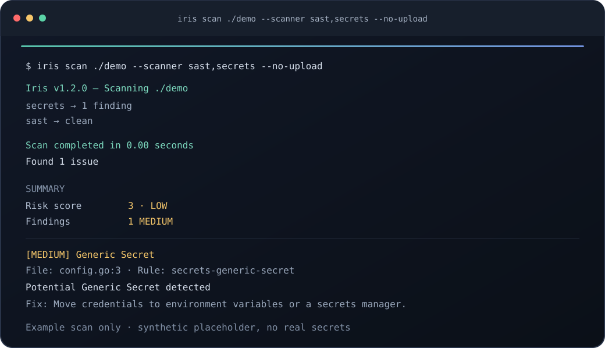
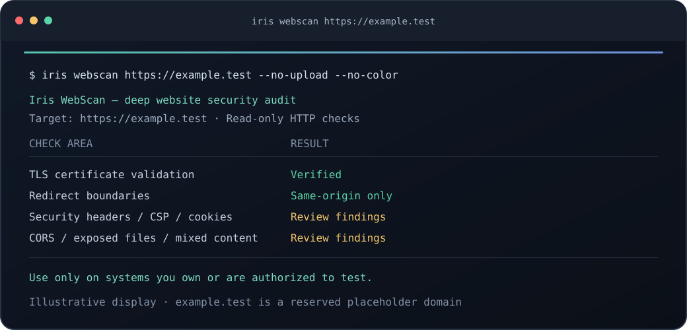

<p align="center">
  
</p>

<p align="center">
  <a href="LICENSE"></a>
  <a href="https://github.com/Pixelcity-dev/iris/releases"></a>
  <a href="https://goreportcard.com/report/github.com/Pixelcity-dev/Iris"></a>
</p>

# Iris

**A practical, open-source security toolkit for code, dependencies, infrastructure, containers, and websites.** Iris brings a set of focused scanners and reporting tools together in one Go CLI, with no runtime installation of language-specific tools required for basic use.

Run scans locally, use them as CI gates, or export results for your existing security workflow. Iris supports Linux, macOS, and Windows; the project is developed by [PixelCity](https://pixelcity.top) and released under the Apache 2.0 license.

> Iris reports potential security issues to help teams investigate and remediate them. Scan only systems and applications you own or are authorized to test. A clean scan is not a guarantee of security or compliance.

## At a glance

- **Application security:** SAST, secret detection, dependency and license analysis.
- **Infrastructure:** Infrastructure-as-code, container, and network checks.
- **Web security:** DAST and WebScan checks for TLS, headers, cookies, CORS, and common exposure risks.
- **Developer workflow:** formatting checks, build-and-test automation, rule lookup, and configuration generation.
- **Useful outputs:** terminal tables, JSON, SARIF, HTML, CycloneDX, SPDX, CSV, and JUnit.
- **CI-friendly:** severity filters, compliance mappings, SARIF reporting, and non-zero exit codes for policy gates.

## Iris in action

The following terminal-style panels illustrate sample output. The code scan uses a synthetic placeholder credential; the website panel uses the reserved `example.test` domain. These are demonstrations, not results from a real production target.

<p align="center">
  
</p>

<p align="center">
  
</p>

## Install

### Installer

```sh
curl -fsSL https://cdn.pixelcity.dev/iris/install.sh | sh
```

The installer selects a release for your platform and verifies its SHA-256 checksum. It installs to `~/.local/bin` by default; set `INSTALL_DIR` to choose another destination.

### Go

```sh
go install github.com/Pixelcity-dev/Iris/cmd/iris@latest
```

### Build from source

```sh
git clone https://github.com/Pixelcity-dev/iris.git
cd iris
make build
```

See [releases](https://github.com/Pixelcity-dev/iris/releases) for downloadable binaries and checksums. Run `iris --help` for the current command list.

## Quick start

```sh
# Scan a repository with selected scanners
iris scan . --scanner sast,sca,secrets

# Scan a website you are authorized to test
iris webscan https://example.com

# Write a machine-readable report
iris scan . --format sarif --output iris-results.sarif

# Use findings as a CI gate
iris scan . --severity high --exit-code

# Check or fix supported formatting issues
iris fmt . --check
iris fmt . --fix
```

For project configuration, start with `iris init`. Use `iris scan --help`, `iris webscan --help`, and `iris fmt --help` for supported flags and formats.

## Capabilities

| Area | What Iris can check |
| --- | --- |
| **SAST** | Common security weaknesses in supported source languages. |
| **SCA** | Known vulnerable dependencies across supported package ecosystems. |
| **Secrets** | Potential credentials and keys in source and project files. |
| **IaC & containers** | Risky configuration in infrastructure and container build assets. |
| **DAST & WebScan** | Website and application exposure checks, including TLS, security headers, cookies, CORS, and common misconfigurations. WebScan also includes deeper, safe probes for selected checks. |
| **Network & licenses** | Network-service checks and license inventory/compliance reporting. |
| **Format & buildtest** | Formatting checks and automated build/test workflows. |

Scanner coverage and checks evolve; consult `iris --help` and the [documentation](https://pixelcity.top/docs/iris) for the current options. Website checks make network requests and should only be used with explicit authorization.

## Reports and CI

Choose an output format with `--format` and optionally write it with `--output`. SARIF can be uploaded to GitHub Code Scanning; HTML is suitable for sharing a human-readable report. CycloneDX and SPDX are available for software inventory workflows.

```sh
iris scan . --format html --output iris-report.html
iris scan . --format cyclonedx --output iris-sbom.json
iris scan . --severity high --exit-code
```

Example GitHub Actions step:

```yaml
- name: Scan with Iris
  run: iris scan . --scanner sast,sca,secrets --severity high --format sarif --output iris-results.sarif

- name: Upload SARIF
  uses: github/codeql-action/upload-sarif@v3
  with:
    sarif_file: iris-results.sarif
```

Iris also provides a composite GitHub Action under `.github/actions/iris`. See the repository's [Action metadata](.github/actions/iris/action.yml) for details.

## Configuration and documentation

Run `iris init` to scaffold `.iris.yaml`. Configure scanners, severity thresholds, exclusions, and compliance mappings there, or view the supported flags with `iris scan --help`.

- [Online documentation](https://pixelcity.top/docs/iris)
- [Documentation source](docs/iris/index.html)
- [Upcoming features](docs/upcoming-features.md)
- [Release downloads](https://github.com/Pixelcity-dev/iris/releases)

## Contributing and security

Contributions are welcome. Please open an issue to discuss larger changes and submit pull requests with relevant tests. Report security concerns privately to [service@pixelcity.dev](mailto:service@pixelcity.dev) rather than posting exploit details publicly.

## License

Iris is distributed under the [Apache License 2.0](LICENSE). Copyright © PixelCity.

## PixelCity:
 - [Homepage](https://pixelcity.dev)
 - [DC - Support](https://discord.gg/8BxaVG6fFm)
 - [Mail - Support](mailto:service@pixelcity.dev)
